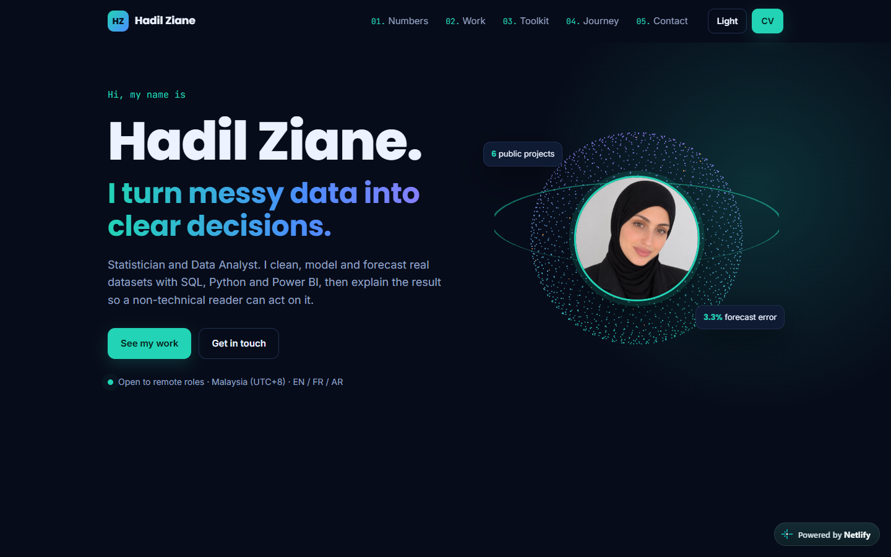

# Data Analyst & Data Scientist Portfolio

My data analyst & data scientist portfolio website — **live at [hadil-ziane.netlify.app](https://hadil-ziane.netlify.app)**.

A single-page site that presents six end-to-end data projects with their real numbers, built by hand with an interactive **Three.js point-cloud globe** in the hero.

**Stack:** HTML · CSS · JavaScript · Three.js · Netlify



---

## ✨ Highlights

- **3D data globe** — 1,600 points on a Fibonacci sphere around my photo, coloured by theme and tilting with the mouse (Three.js).
- **Key results as KPI cards** with real-data sparklines (Pareto of revenue, forecast error by horizon, gas share, churn gains) drawn as inline SVG.
- **Flagship project in depth**, then project cards that open a **case-study drawer** (Problem → Action → Result) built with the native `<dialog>` element.
- **Filter by skill** (SQL / Modelling), **dark / light theme** saved per visitor, animated journey timeline, reveal-on-scroll.
- **Responsive & accessible** — mobile layout, focus styles, `prefers-reduced-motion` respected.

## 📊 Projects featured

| Project | Repo |
|---|---|
| Job Postings Monitor — 17 forecasting models backtested | [job-postings-forecast](https://github.com/Hadil16/job-postings-forecast) |
| Energy Shift — SQL window functions, 219 countries | [energy-transition-analysis](https://github.com/Hadil16/energy-transition-analysis) |
| Customer Segmentation (RFM) & retention cohorts | [customer-segmentation-rfm](https://github.com/Hadil16/customer-segmentation-rfm) |
| Telco Churn — logistic regression, AUC 0.845 | [telco-churn-analysis](https://github.com/Hadil16/telco-churn-analysis) |
| Olist — late deliveries vs reviews | [olist-ecommerce-analysis](https://github.com/Hadil16/olist-ecommerce-analysis) |
| Superstore — where discounts destroy profit | [superstore-profit-analysis](https://github.com/Hadil16/superstore-profit-analysis) |

## 🚀 Run locally

```bash
node serve.js
```
Then open http://localhost:3213.

---

**Author:** Hadil Ziane · [Live site](https://hadil-ziane.netlify.app) · [GitHub](https://github.com/Hadil16) · Also a software engineer: [software portfolio](https://hadil-ziane-dev.netlify.app)
